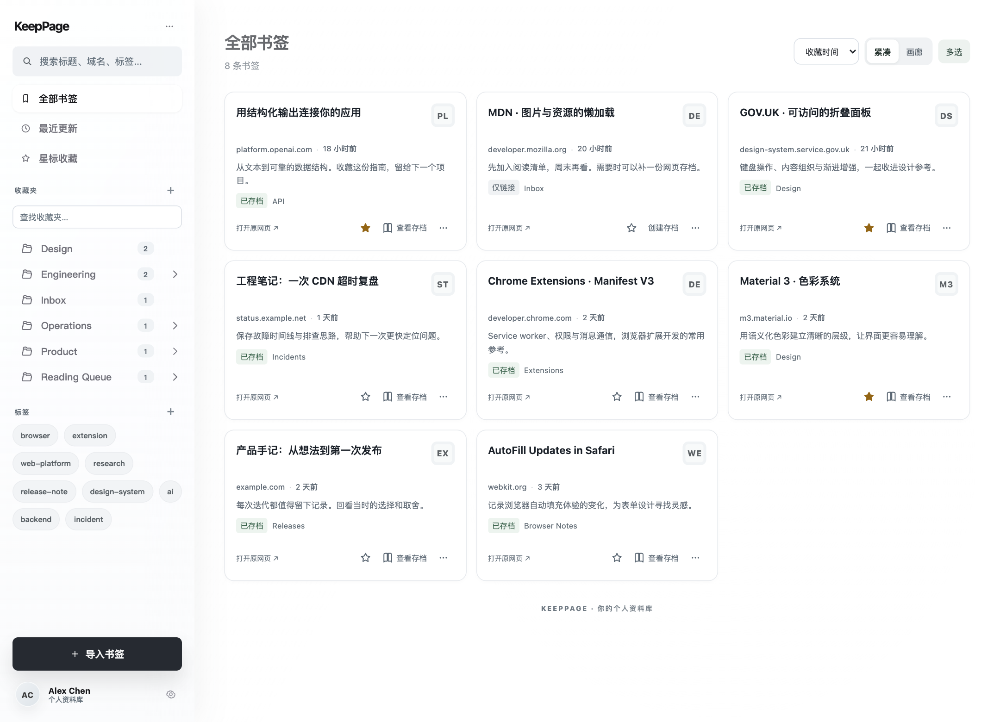
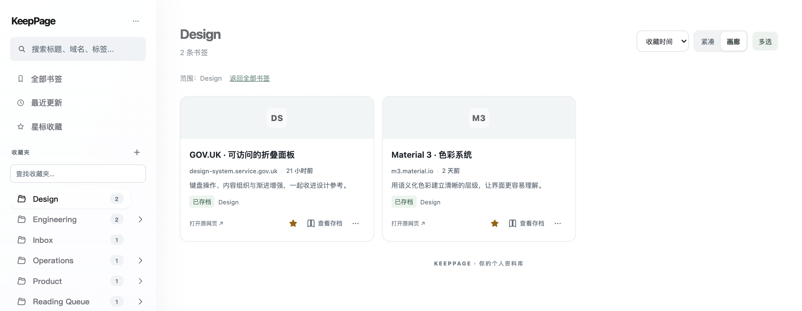
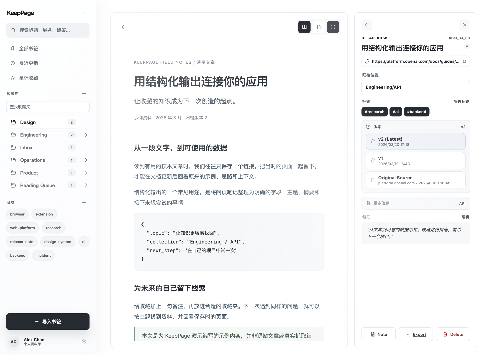
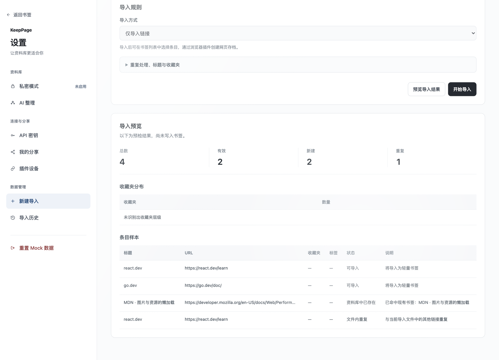

<div align="center">

# KeepPage

**留住网页，也留住有用的内容。**

支持自部署的网页收藏与归档工具，搭配 Chrome 扩展，
保存网页快照、整理个人资料库，随时回看值得留下的内容。

[English](README.md) · **简体中文**

[快速开始](#快速开始) · [自部署](#自部署) · [文档](#文档) · [参与贡献](CONTRIBUTING.md)


</div>



*截图来自 KeepPage 当前界面，使用虚构演示数据。产品界面目前以中文为主，中英文 README 共用同一组截图。*

## 为什么使用 KeepPage？

书签让你找回网址，网页快照让你回看当时想留下的内容——即使原网页已经更新或消失。

KeepPage 将书签管理和浏览器生成的 HTML 归档放进同一个个人资料库，适合收集技术文档、设计灵感、待读文章与研究资料。

- **在浏览器中保存。** 使用 SingleFile 生成网页归档，保存在本地任务队列，再同步到你的服务器。
- **让收藏有条理。** 使用多级收藏夹、标签、星标、备注和批量操作整理资料。
- **找到并回看内容。** 搜索资料库，打开已保存的历史版本，下载可用的 HTML 归档。
- **自己选择存储位置。** 自行部署 Go API 与 React Web，使用 PostgreSQL 存储元数据，使用本地磁盘或 Cloudflare R2 保存归档。

## 功能一览

### 整理与查找

组合使用收藏夹、标签与搜索，切换紧凑或画廊视图，也可以一次整理多条书签。



### 回看保存的网页

预览可用的原始归档或阅读视图，切换已保存的版本，导出 HTML 供日后阅读。抓取质量诊断帮助识别内容缺失。



*图中文章为演示编写，并非对应源站的真实抓取结果。*

### 带上已有收藏

支持浏览器书签 HTML、URL 列表和 CSV 导入，提交前可预览重复处理结果。导入先添加链接，之后可通过浏览器扩展为选中的条目创建存档。



### 更多能力

| 能力 | 说明 |
| --- | --- |
| 分享 | 为选中的普通书签创建只读分享链接，支持撤销。 |
| 私密模式 | 使用独立查询和密码访问控制隔离私密内容，**不是端到端加密**。 |
| AI 整理 | 配置模型连接后运行分类任务，需要自备兼容服务与凭据。 |
| API 密钥与设备 | 管理程序访问凭据和已连接的浏览器扩展。 |
| 备份 | 可配置普通书签定时备份到 R2，具体覆盖范围见[备份说明](docs/bookmark-backup-to-r2.md)。 |

## 快速开始

### 先体验界面

只需要 **Node.js 24**（见 [`.nvmrc`](.nvmrc)）和 npm：

```bash
git clone https://github.com/iwascy/KeepPage.git
cd KeepPage
npm ci
npm run dev:web:mock
```

打开 [localhost:5173](http://localhost:5173)，无需 API、数据库、扩展或真实账号。访问[宣传演示入口](http://localhost:5173/demo.html?showcase=1)，即可体验截图使用的数据。

演示中的修改会在刷新后重置。私密模式、外部 AI 服务与浏览器抓取没有完整模拟；正式应用在 API 失败时不会自动回退到 mock 数据。

### 运行完整应用

在 Node.js/npm 之外，安装 **Go 1.24+** 和 Chrome。安装项目依赖后，在**不同终端**中分别运行：

```bash
# 终端 1 — Go API，http://127.0.0.1:8787
npm run dev:api
```

```bash
# 终端 2 — Web，http://localhost:5173
npm run dev:web
```

Web 开发服务器会将 `/api` 代理到 Go API。在 Web 中注册账号后即可使用。默认 `memory` 仓储适合体验：API 重启后账号与书签元数据会丢失。长期使用请配置 PostgreSQL。

### 连接 Chrome 扩展

在仓库根目录一键构建插件：

```bash
./build-extension.sh
```

脚本在缺少 WXT 时会自动执行 `npm ci` 安装依赖。也可以先执行 `npm ci`，再执行 `npm run build -w @keeppage/extension`。

1. 打开 `chrome://extensions`，启用**开发者模式**。
2. 点击**加载已解压的扩展程序**，选择 `apps/extension/.output/chrome-mv3`。
3. 打开扩展 Side Panel，将 API 地址设为 `http://127.0.0.1:8787`，连接你的账号。
4. 通过工具栏弹窗保存书签；需要保存网页内容时，在 Side Panel 中创建归档并同步。
5. 回到 Web 资料库，点击**查看存档**回看保存的网页。

工具栏保存书签**不会自动生成网页归档**。抓取、队列与同步操作详见[使用说明](docs/usage.md)。

## 自部署

推荐使用 **Go API + PostgreSQL + Web**，前后端同域部署，通过 `/api` 反向代理访问后端。归档对象可选择持久化本地磁盘或 Cloudflare R2。

本地 PostgreSQL 配置示例，在同一终端中设置并启动 API：

```bash
export STORAGE_DRIVER=postgres
export DATABASE_URL='postgresql://<user>:<password>@127.0.0.1:5432/keeppage'
export OBJECT_STORAGE_DRIVER=localfs
export OBJECT_STORAGE_ROOT="$PWD/apps/api-go/data/object-storage"
npm run db:init -w @keeppage/api-go
npm run dev:api
```

数据库服务需提前启动。初始化命令会在需要时创建数据库（要求相应权限），并执行 Go 后端迁移。

| 配置项 | 用途 |
| --- | --- |
| `DATABASE_URL` | 保存持久化元数据的 PostgreSQL 连接串。 |
| `OBJECT_STORAGE_DRIVER` | 选择 `localfs` 或 `r2`。 |
| `OBJECT_STORAGE_ROOT` | 使用 `localfs` 时的持久化归档目录。 |
| `API_PUBLIC_BASE_URL` | 浏览器可访问的 API 地址，例如 `https://keep.example.com/api`。 |
| `R2_*` | 使用 R2 时的 bucket、endpoint 和凭据，详见部署说明。 |

现有 [Docker Compose 配置](deploy/docker-compose.yml) 使用特定部署主机的路径，可作为部署参考。使用前需调整挂载目录、环境文件和端口，不能直接当成通用一键安装器。

对象存储、反向代理、扩展分发及 TypeScript 后端回滚配置见[部署说明](docs/deployment.md)。备份时同时保留数据库元数据与归档对象。

## 开发

| 目录 | 职责 |
| --- | --- |
| `apps/web` | React + Vite Web，正式与演示模式共用组件。 |
| `apps/extension` | WXT Chrome MV3 扩展、抓取队列与同步。 |
| `apps/api-go` | 生产 Go API、PostgreSQL 仓储与迁移。 |
| `apps/api` | 保留的 TypeScript/Fastify 回滚后端。 |
| `packages/domain` | 共享 TypeScript 契约、schema 与抓取质量规则。 |
| `packages/db` | Drizzle schema 与 TypeScript 后端迁移。 |

```bash
npm run typecheck                  # TypeScript 检查与 Go 测试
npm run build -w @keeppage/web      # Web 生产构建
npm run dev:extension              # 扩展开发
npm run build:demo:html            # 单文件演示，输出到 apps/web/dist-standalone/
```

Go 生产迁移位于 `apps/api-go/migrations/`。定向测试、扩展版本更新和文档维护约定见 [CONTRIBUTING.md](CONTRIBUTING.md)。

## 文档

详细操作文档目前以中文维护。

- [文档导航](docs/README.md)
- [使用与故障排查](docs/usage.md)
- [部署说明](docs/deployment.md) · [架构说明](docs/architecture.md)
- [登录会话](docs/auth-sessions.md) · [备份说明](docs/bookmark-backup-to-r2.md)
- [UI 功能回归范围](docs/ui-refactor-baseline.md)
- [重新生成 README 截图](docs/screenshots.md)

## 当前边界

KeepPage 仍在持续迭代。归档效果因站点而异，动态媒体、嵌入框架和受保护内容可能无法完整保留。演示截图用于展示界面，不代表对图中网站抓取质量的保证。当前文档覆盖的扩展目标是 Chrome MV3。

## 参与贡献

欢迎提交问题报告、文档修正和范围明确的 PR。请先阅读[贡献指南](CONTRIBUTING.md)，也可以直接[报告问题](https://github.com/iwascy/KeepPage/issues/new?template=bug_report.md)或[提出功能建议](https://github.com/iwascy/KeepPage/issues/new?template=feature_request.md)。

## 许可证与致谢

**项目整体许可证尚未确定。** 源码公开不等于已授予开源许可证。复用或再分发前，请先查看[许可证说明](docs/legal/singlefile-license.md)。

KeepPage 使用 [SingleFile core](https://github.com/gildas-lormeau/single-file-core) 完成抓取，其许可证为 **AGPL-3.0-or-later**；同时感谢 [Mozilla Readability](https://github.com/mozilla/readability)、[WXT](https://wxt.dev/)、[React](https://react.dev/) 和 [Go](https://go.dev/)。第三方组件保留各自的许可证。
